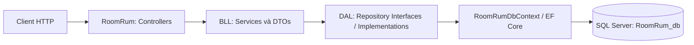
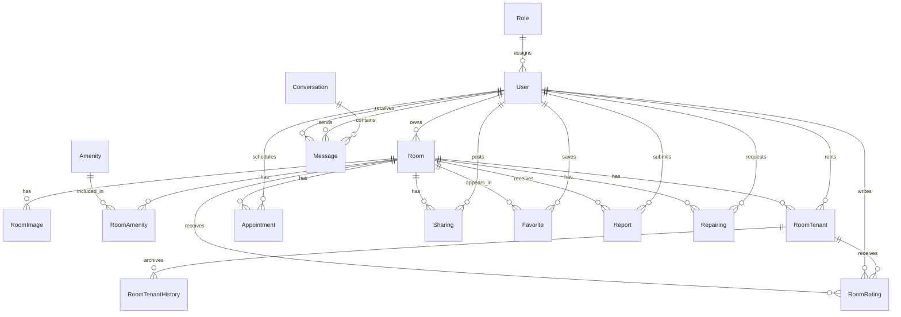

# Kiến trúc dự án PRN232-RoomRum

## 1. Tổng quan

PRN232-RoomRum là backend ASP.NET Core cho hệ thống phòng trọ. Dự án được tổ chức theo kiến trúc phân lớp gồm ba tầng:

- **RoomRum — API/Presentation Layer:** nhận HTTP request, xác thực/phân quyền và trả HTTP response.
- **BLL — Business Logic Layer:** kiểm tra quy tắc nghiệp vụ, điều phối repository và ánh xạ request/response DTO.
- **DAL — Data Access Layer:** quản lý entity, ánh xạ EF Core, truy vấn, lưu dữ liệu và transaction.

Các chức năng hiện có gồm tài khoản, quản trị, phòng/tiện ích/ảnh, lịch hẹn, yêu thích, ở ghép, thuê phòng và lịch sử thuê, đánh giá, báo cáo, sửa chữa và chat.

## 2. Công nghệ và cấu trúc mã nguồn

| Thành phần | Công nghệ/cấu hình |
| --- | --- |
| Ngôn ngữ | C# |
| Nền tảng | .NET 10, nullable reference types và implicit usings |
| Web API | ASP.NET Core Controllers |
| Đặc tả API | NSwag.AspNetCore 14.7.1, Swagger UI tại `/swagger` |
| ORM | Entity Framework Core SQL Server 10.0.12 |
| Cơ sở dữ liệu | SQL Server, schema trong `Database/DB.sql` |
| Xác thực | JWT Bearer; BCrypt để băm mật khẩu |
| Solution | `PRN232-RoomRum/RoomRum/RoomRum.slnx` |

```text
PRN232-GroupProject/
├── ARCHITECTURE.md
├── README.md
└── PRN232-RoomRum/
    ├── RoomRum/                         # API/Presentation, project khởi chạy
    │   ├── Controllers/                 # Mỗi controller một tệp
    │   ├── Program.cs                   # Composition root và HTTP pipeline
    │   ├── ApiResponse.cs
    │   ├── ApiErrorEnvelopeMiddleware.cs
    │   ├── ExceptionHandlingMiddleware.cs
    │   ├── ErrorResponsesOperationProcessor.cs
    │   ├── UtcDateTimeJsonConverter.cs
    │   ├── appsettings.example.json     # Mẫu cấu hình không chứa bí mật
    │   ├── appsettings.json             # Cấu hình cục bộ, không commit
    │   ├── RoomRum.csproj
    │   ├── RoomRum.http
    │   ├── RoomRum.run.json              # Profile phụ; launchSettings.json được ưu tiên
    │   └── RoomRum.slnx
    ├── BLL/                             # Business Logic
    │   ├── DTOs/
    │   │   ├── JwtSettings.cs
    │   │   ├── Requests/
    │   │   └── Responses/
    │   ├── Services/
    │   │   ├── Paging.cs
    │   │   ├── Interfaces/
    │   │   └── Implementations/
    │   └── BLL.csproj
    ├── DAL/                             # Data Access
    │   ├── Entities/
    │   │   ├── RoomRumDbContext.cs
    │   │   └── ...                      # Entity nghiệp vụ
    │   ├── Repositories/
    │   │   ├── Interfaces/
    │   │   └── Implementations/
    │   └── DAL.csproj
    ├── Database/                        # SQL, migration, seed, script kiểm tra
    ├── Directory.Build.props            # Đưa bin/obj ra artifacts
    ├── artifacts/                       # Đầu ra build, Git ignore
    └── .gitignore
```

Tên thư mục/project API là `RoomRum` theo cấu trúc kiến trúc. Namespace API vẫn là `RoomRum.API`; namespace BLL/DAL lần lượt là `RoomRum.BLL` và `RoomRum.DAL`.

Thư mục con trực tiếp của từng project được giới hạn: **BLL chỉ có `DTOs`, `Services`; DAL chỉ có `Entities`, `Repositories`; RoomRum chỉ có `Controllers`**. Các tệp khởi chạy, cấu hình và hỗ trợ HTTP nằm tại gốc `RoomRum`. SQL/script nằm ngoài các project trong `PRN232-RoomRum/Database`. `Directory.Build.props` chuyển đầu ra build và tệp trung gian vào `PRN232-RoomRum/artifacts` để không sinh `bin`, `obj` trong ba project.

## 3. Phân chia trách nhiệm và phụ thuộc

### 3.1. RoomRum — tầng API

[Program.cs](PRN232-RoomRum/RoomRum/Program.cs) là composition root:

1. Đăng ký controllers và JSON camelCase.
2. Đăng ký `RoomRumDbContext`, repository và service trực tiếp bằng DI.
3. Cấu hình JWT, authorization, rate limiter, CORS và Swagger.
4. Đăng ký middleware xử lý lỗi và ánh xạ controller.

Controller nhận request DTO, lấy danh tính/vai trò từ request, gọi service qua interface và chuyển `ApiOutcome` thành HTTP response có envelope `{ success, message, data }`. Các thao tác trả 204 không có response body.

Controller không truy cập entity, repository hay EF Core. Sự kiện kiểm tra JWT gọi `IAuthService.ValidateIdentity`; tài khoản bị khóa hoặc đổi vai trò sẽ không tiếp tục dùng token cũ.

### 3.2. BLL — tầng nghiệp vụ

| Thư mục | Trách nhiệm |
| --- | --- |
| `Services/Interfaces` | Hợp đồng nghiệp vụ mà API sử dụng |
| `Services/Implementations` | Validation, quyền sở hữu, quy tắc chuyển trạng thái, điều phối repository và mapping |
| `DTOs/Requests` | Dữ liệu đầu vào của từng thao tác |
| `DTOs/Responses` | Dữ liệu công khai trả về; không đưa `Password` vào response |
| `DTOs/Responses/ApiOutcome.cs` | Kết quả nghiệp vụ để controller chuyển thành HTTP response |
| `DTOs/JwtSettings.cs` | Dữ liệu cấu hình ký access token |
| `Services/Paging.cs` | Quy tắc kiểm tra phân trang dùng chung giữa các service |

Có 11 interface/service: auth, admin, room, appointment, favorite, sharing, rating, room tenant, chat, report và repair. Mỗi interface và implementation nằm trong một tệp riêng.

BLL chỉ nhận repository qua constructor; không dùng `DbContext`, `DbSet`, EF query extension, SQL client hoặc transaction trực tiếp. Mapping response được truyền bằng expression selector để DAL có thể chiếu đúng cột bằng SQL mà không phụ thuộc DTO của BLL.

### 3.3. DAL — tầng truy cập dữ liệu

[RoomRumDbContext](PRN232-RoomRum/DAL/Entities/RoomRumDbContext.cs) và các entity nằm trong `Entities`. Context nhận `DbContextOptions` từ DI, không chứa connection string cứng hay tự kết nối trong `OnConfiguring`.

Repository được chia theo nhóm dữ liệu: room, user, amenity, appointment, favorite, sharing, rating, room tenant, chat, report và repair. Các implementation đóng gói:

- Truy vấn, điều kiện lọc, sắp xếp và phân trang.
- Theo dõi entity khi ghi; `AsNoTracking` khi đọc.
- Thêm/xóa/lưu dữ liệu và xử lý unique-key race cho tiện ích/yêu thích.
- Cập nhật có điều kiện để tránh ghi đè khi trạng thái lịch hẹn, duyệt phòng hoặc thuê phòng thay đổi đồng thời.
- Transaction lưu lịch sử thuê trước khi mở lại lời mời thuê.

Repository trả entity, dữ liệu được chiếu hoặc kết quả thao tác; không trả HTTP response hay tham chiếu DTO/service của BLL. Không trả `IQueryable` hay `DbSet` ra ngoài DAL.

`Repository<TEntity>` chia sẻ thao tác tracked CRUD và `SaveChangesAsync`. Tất cả repository và context có lifetime `Scoped`, dùng chung context trong một HTTP request. Vì vậy một lần lưu có thể ghi nhất quán các thay đổi liên quan, ví dụ thêm người thuê và đổi trạng thái phòng.

### 3.4. Sơ đồ kiến trúc và tham chiếu project



Các `ProjectReference`:

- `RoomRum` → `BLL`: service interfaces, implementation và DTO; đăng ký BLL tại `Program.cs`.
- `BLL` → `DAL`: repository interfaces và entity nội bộ.
- `RoomRum` → `DAL`: đăng ký data access tại composition root; middleware ánh xạ lỗi lưu trữ sang HTTP.
- `DAL` không tham chiếu lên `BLL` hoặc API.

## 4. Mô hình dữ liệu

Context có **15 DbSet**; bảng nối `RoomAmenity` được ánh xạ bằng shared-type entity `Dictionary<string, object>`. Tổng cộng schema có 16 bảng.

| Nhóm | Entity |
| --- | --- |
| Tài khoản/vai trò | `User`, `Role` |
| Phòng và mô tả | `Room`, `RoomImage`, `Amenity` |
| Ở ghép | `Sharing` |
| Lịch hẹn | `Appointment` |
| Thuê phòng và lịch sử | `RoomTenant`, `RoomTenantHistory` |
| Đánh giá | `RoomRating` |
| Yêu thích | `Favorite` |
| Báo cáo/sửa chữa | `Report`, `Repairing` |
| Chat | `Conversation`, `Message` |

### 4.1. Quan hệ chính



`Conversation` không có bảng thành viên; người tham gia được suy ra từ `Message.Sender/Receiver`. Service kiểm tra quyền đọc/gửi, kể cả cuộc hội thoại cũ có dữ liệu của nhiều cặp người dùng.

### 4.2. Ràng buộc và trạng thái

- ID chủ yếu là `Guid`; `RoomTenant` có khóa ghép `(RoomId, UserId)`.
- Lời mời thuê mới là `Pending`; người được mời chấp nhận thì thành `Active`. Kết thúc thuê là `Ended`, hủy lời mời là `Cancelled`. Khi mời lại, kỳ trước được lưu vào `RoomTenantHistory` trong cùng transaction.
- `RoomRating` có unique index `(UserId, RoomId)`, khóa ngoại ghép đến `RoomTenant`. BLL yêu cầu tenancy `Active` hoặc `Ended` trước khi đánh giá.
- `Favorite` có unique index `(UserId, RoomId)`; tên tiện ích và tên vai trò cũng có unique index.
- Email và citizen ID có unique index có filter cho dữ liệu tùy chọn. API đăng ký vẫn yêu cầu email.
- Giá/phí dùng `decimal(18, 2)`; diện tích dùng `decimal(10, 2)`. BLL kiểm tra giới hạn và độ chính xác trước khi lưu.
- Phòng có các trạng thái `Pending`, `Available`, `Rented`, `Hidden`, `Cancelled`. Tạo phòng luôn là `Pending`; request tạo/sửa không nhận trường `status`. Admin duyệt sang `Available` hoặc `Cancelled`.
- Tìm phòng và đặt lịch mới chỉ chấp nhận `Available`; chi tiết công khai chấp nhận `Available` và `Rented`.
- Lịch hẹn mặc định `Pending`; BLL kiểm tra người đặt/chủ phòng và trạng thái đích trước khi DAL thực hiện cập nhật có điều kiện.

Sau khi tích hợp nhánh Huy, schema `Room` có thêm tọa độ tùy chọn và API có thêm tìm kiếm nâng cao, tra cứu địa điểm, mời người thuê bằng email và tải ảnh phòng. Các route và quy tắc duyệt phòng của Khoa vẫn giữ nguyên.

## 5. Luồng xử lý nghiệp vụ

Ví dụ tạo lịch hẹn xem phòng:

1. Client gửi `POST /api/appointments` với JWT và `AppointmentRequest`.
2. `AppointmentsController` lấy user ID và gọi `IAppointmentService.Create`.
3. `AppointmentService` lấy phòng qua `IRoomRepository`, kiểm tra trạng thái phòng, quyền sở hữu và thời gian.
4. Service tạo entity `Appointment` và gọi `IAppointmentRepository.Add/SaveChangesAsync`.
5. `AppointmentRepository` dùng `RoomRumDbContext` để lưu SQL Server.
6. Service trả `AppointmentMutationResponse` trong `ApiOutcome.Created`; API chuyển thành HTTP 201 với envelope.

## 6. Cấu hình và chạy cục bộ

Yêu cầu .NET 10 SDK và SQL Server đã chuẩn bị schema. Từ thư mục gốc:

```powershell
# Đảm bảo RoomRum/appsettings.json có chuỗi kết nối DB và JWT key phù hợp.
dotnet restore .\PRN232-RoomRum\RoomRum\RoomRum.slnx
dotnet build .\PRN232-RoomRum\RoomRum\RoomRum.slnx
dotnet run --project .\PRN232-RoomRum\RoomRum\RoomRum.csproj --launch-profile http
```

`WebApplication.CreateBuilder(args)` tự đọc `appsettings.json`; project không đọc trực tiếp `appsettings.example.json`. Sao chép file mẫu thành `appsettings.json`, điền chuỗi kết nối và JWT key riêng trên mỗi máy. File cục bộ được Git ignore để không commit bí mật. Có thể ghi đè từng giá trị bằng biến môi trường `ConnectionStrings__RoomRumConnection` và `Jwt__Key`.

- HTTP: `http://localhost:5041`.
- HTTPS: `https://localhost:7258`, đồng thời có HTTP 5041.
- `Properties/launchSettings.json` được ưu tiên khi chạy project; profile `RoomRum` dùng HTTP 5041.
- Swagger UI: `/swagger`; JSON: `/swagger/v1/swagger.json`.
- `Cors:AllowedOrigins` cấu hình web origin được phép; Development chấp nhận thêm localhost/127.0.0.1.
- `RateLimiting:AuthPermitLimit` giới hạn tổng request đăng ký/đăng nhập theo IP mỗi phút.
- `Database/DB.sql` là baseline xóa và tạo lại database. Với database đang có dữ liệu, dùng các migration riêng theo [README API](PRN232-RoomRum/RoomRum/README.md); không chạy lại baseline.

Các script kiểm tra cần PowerShell 7, SQLCMD và SQL Server phù hợp; chạy khi API đang hoạt động:

```powershell
pwsh -File .\PRN232-RoomRum\Database\verify-api.ps1 -BaseUrl http://localhost:5041 -SqlServer '.\SQLEXPRESS'
pwsh -File .\PRN232-RoomRum\Database\verify-all.ps1 -BaseUrl http://localhost:5041 -SqlServer '.\SQLEXPRESS'
```

Các script tạo dữ liệu kiểm thử tạm và dọn trong `finally`. Khởi động lại API giữa các lần chạy để đặt lại bộ đếm rate limiter. `verify-schema.ps1` so sánh database đích với database tham chiếu đã chuẩn bị.

## 7. Phạm vi hiện có

| Hạng mục | Trạng thái |
| --- | --- |
| Project, namespace, DTO, service, repository và DI | Đã tổ chức theo ba tầng |
| Nghiệp vụ, validation, JWT, phân quyền, envelope lỗi | Có triển khai |
| SQL baseline, migration và seed | Trong `PRN232-RoomRum/Database`, ngoài ba project |
| Kiểm tra API và schema | Các script PowerShell có sẵn |
| Thanh toán, notification, refresh token | Schema hiện tại chưa hỗ trợ |
| Lưu file ảnh và chat thời gian thực | Chưa triển khai; hiện lưu URL ảnh và chat qua HTTP |
| Frontend, container và CI/CD | Ngoài phạm vi lần tổ chức lại này |

## 8. Các tệp tham chiếu

- [Solution](PRN232-RoomRum/RoomRum/RoomRum.slnx)
- [Project API](PRN232-RoomRum/RoomRum/RoomRum.csproj), [BLL](PRN232-RoomRum/BLL/BLL.csproj), [DAL](PRN232-RoomRum/DAL/DAL.csproj)
- [HTTP pipeline](PRN232-RoomRum/RoomRum/Program.cs)
- [Đăng ký DI cho BLL/DAL](PRN232-RoomRum/RoomRum/Program.cs)
- [DbContext và entity](PRN232-RoomRum/DAL/Entities/)
- [Service](PRN232-RoomRum/BLL/Services/), [DTO](PRN232-RoomRum/BLL/DTOs/)
- [Repository](PRN232-RoomRum/DAL/Repositories/)
- [Điểm đọc cấu hình DB và JWT](PRN232-RoomRum/RoomRum/Program.cs)
- [Profile chạy cục bộ](PRN232-RoomRum/RoomRum/RoomRum.run.json)
- [SQL và script kiểm tra](PRN232-RoomRum/Database/)
- [Cấu hình đầu ra build](PRN232-RoomRum/Directory.Build.props)
